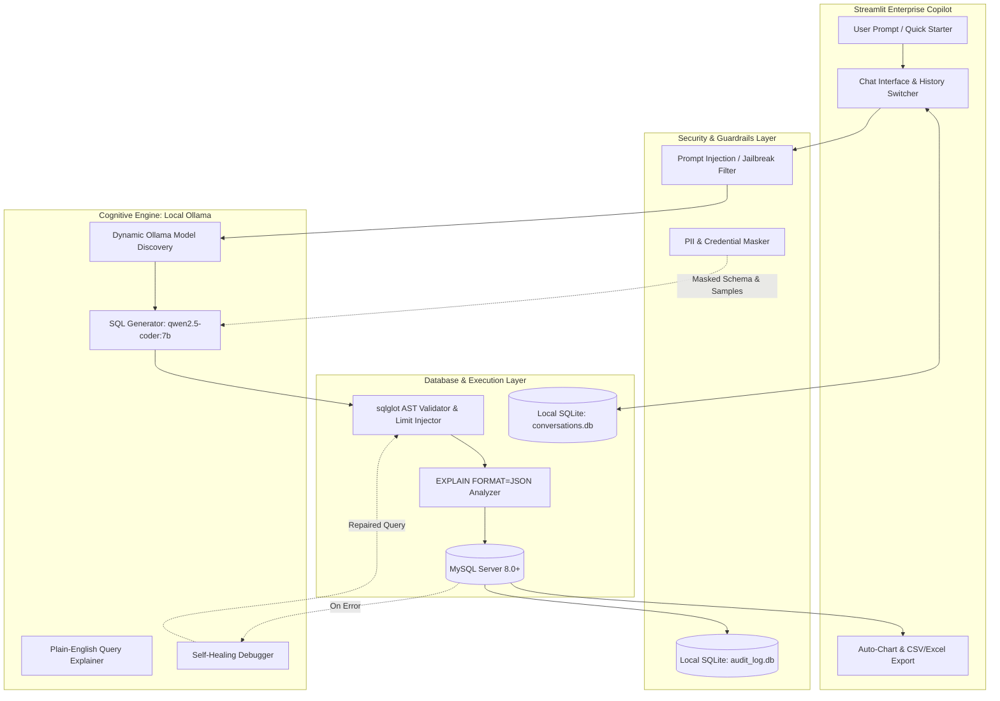

# 🗄️ NL2SQL Enterprise AI Copilot

[](https://www.python.org/)
[](https://streamlit.io/)
[](https://ollama.com/)
[](https://www.mysql.com/)
[](LICENSE)

An enterprise-grade, privacy-first **Natural Language to SQL (NL2SQL)** conversational copilot. Translate plain English into executable MySQL queries with multi-session chat history, Abstract Syntax Tree (AST) guardrails, automated data visualizations, query cost estimation, and self-healing query repair—running **100% locally and offline**.

---

## 📑 Table of Contents
1. [Core Features](#-core-features)
2. [System Architecture](#-system-architecture)
3. [Project Structure](#-project-structure)
4. [Prerequisites](#-prerequisites)
5. [Installation & Setup](#-installation--setup)
   - [Linux (Ubuntu / Debian)](#linux-ubuntu--debian)
   - [macOS](#macos)
   - [Windows 10 / 11](#windows-10--11)
6. [Database Setup & Sample Data](#-database-setup--sample-data)
7. [Environment Configuration (.env)](#-environment-configuration-env)
8. [Running the Application](#-running-the-application)
9. [User Guide & Example Walkthroughs](#-user-guide--example-walkthroughs)
10. [Security & Privacy Guardrails](#-security--privacy-guardrails)
11. [Troubleshooting & FAQ](#-troubleshooting--faq)

---

## 🌟 Core Features

* **💬 ChatGPT-Style Conversational Interface:** Multi-turn chat memory allowing progressive query refinement (e.g., *"Show customers from Pune"* followed by *"Now sort them by name"*).
* **💾 Persistent Local Chat Sessions:** Chat history is saved entirely on your local machine using SQLite (`conversations.db`). Create new sessions, switch between previous discussions, or delete threads with one click.
* **🛡️ Deep AST Validation (`sqlglot` & `sqlparse`):**
  - **Mandatory `WHERE` Clauses:** Prevents catastrophic accidental data loss by enforcing `WHERE` conditions on all `UPDATE` and `DELETE` queries.
  - **Auto-Limit Injection:** Automatically appends `LIMIT 100` on unbounded `SELECT` queries to prevent runaway queries.
  - **Destructive Command Defense:** Rejects administrative and schema-altering statements (`DROP`, `TRUNCATE`, `ALTER`, `GRANT`, `REVOKE`).
* **⚡ EXPLAIN Cost & Scan Volume Analyzer:** Evaluates execution cost and scanned row volume before execution, flagging heavy queries that lack index optimization.
* **🔧 Self-Healing Auto-Repair Loop:** If a query triggers a MySQL error (e.g., misspelled column), click **"🔧 Auto-Fix with Ollama"** to let the model analyze the exact error message against the schema and repair the query.
* **📊 Automated Business Intelligence Charts:** Detects column data types in results and automatically renders interactive Bar Charts (categorical vs numerical) and Line Charts (temporal vs numerical).
* **📥 Dual Export (CSV & Excel `.xlsx`):** Download query results in UTF-8 CSV or formatted Microsoft Excel (`.xlsx`) workbooks.
* **🔒 100% Local Air-Gap & PII Masking:** Zero cloud dependencies, zero external telemetry. Sensitive columns (`password`, `token`, `secret`, `ssn`) are automatically masked (`***MASKED***`) during schema grounding.
* **📋 Tamper-Evident Audit Logging:** Every executed query, execution duration (ms), row count, and status is logged to a local SQLite database (`audit_log.db`).

---

## 🏗️ System Architecture



---

## 📁 Project Structure

```text
Natural_lang2_SQL/
├── app.py                     # Streamlit frontend & interactive chat copilot
├── db.py                      # SQLAlchemy engine, AST validation, EXPLAIN cost analyzer, schema extractor
├── llm.py                     # LangChain & Ollama orchestration, model discovery, explanation, self-healing
├── security.py                # PII masking, prompt injection defense, SQLite audit logger
├── chat_store.py              # Local SQLite chat session persistence and thread manager
├── requirements.txt           # Python package dependencies
├── .env.example               # Example configuration template
├── .env                       # Local environment variables (git-ignored)
├── .gitignore                 # Excludes venv, local databases (*.db), and credentials
├── .streamlit/
│   └── config.toml            # Zero-telemetry and security configuration
└── docs/
    ├── production_roadmap.md  # Detailed enterprise production roadmap (Sections A, B, C)
    └── feature_ideation.md    # 5 upcoming innovation features (Multilingual, Voice, ERD, etc.)
```

---

## ⚙️ Prerequisites

Before getting started, make sure you have the following installed on your operating system:
1. **Python 3.10, 3.11, or 3.12**
2. **Git**
3. **MySQL Server 8.0+**
4. **Ollama** (for running local LLMs offline)

---

## 🚀 Installation & Setup

### Linux (Ubuntu / Debian)

#### 1. Install Ollama & Pull the Model
```bash
# Install Ollama
curl -fsSL https://ollama.com/install.sh | sh

# Pull the recommended SQL coding model
ollama pull qwen2.5-coder:7b

# (Optional) Verify model is ready
ollama list
```

#### 2. Install MySQL Server & Python venv
```bash
sudo apt update
sudo apt install -y mysql-server python3-venv python3-pip git
sudo systemctl enable --now mysql
```

#### 3. Clone Repository & Set Up Virtual Environment
```bash
# Clone the repository
git clone https://github.com/YashBaraii/Natural_lang2_SQL.git
cd Natural_lang2_SQL

# Create virtual environment
python3 -m venv venv

# Activate virtual environment
source venv/bin/activate

# Install dependencies
pip install -r requirements.txt
```

---

### macOS

#### 1. Install Ollama & Pull the Model
```bash
# Install Ollama via Homebrew (or download from https://ollama.com/download)
brew install ollama

# Start the Ollama background service
brew services start ollama

# Pull the model
ollama pull qwen2.5-coder:7b
```

#### 2. Install MySQL Server
```bash
brew install mysql
brew services start mysql
```

#### 3. Clone Repository & Set Up Virtual Environment
```bash
git clone https://github.com/YashBaraii/Natural_lang2_SQL.git
cd Natural_lang2_SQL

python3 -m venv venv
source venv/bin/activate
pip install -r requirements.txt
```

---

### Windows 10 / 11

#### 1. Install Ollama & Pull the Model
1. Download and run the Windows installer from [ollama.com/download/windows](https://ollama.com/download/windows).
2. Open **PowerShell** or **Command Prompt** and run:
   ```powershell
   ollama pull qwen2.5-coder:7b
   ```

#### 2. Install MySQL Server
1. Download the [MySQL Community Server Installer](https://dev.mysql.com/downloads/installer/).
2. Complete setup and start the `MySQL80` Windows service.

#### 3. Clone Repository & Set Up Virtual Environment
Open **PowerShell** in your project folder:
```powershell
git clone https://github.com/YashBaraii/Natural_lang2_SQL.git
cd Natural_lang2_SQL

# Create virtual environment
python -m venv venv

# Activate virtual environment (PowerShell)
.\venv\Scripts\Activate.ps1
# (Or in Command Prompt: venv\Scripts\activate.bat)

# Install dependencies
pip install -r requirements.txt
```

> **PowerShell Execution Policy Note:** If activation fails, run:  
> `Set-ExecutionPolicy -ExecutionPolicy RemoteSigned -Scope CurrentUser`

---

## 🗄️ Database Setup & Sample Data

To test the application immediately, set up a sample `ecommerce_db` with an application user.

### Open MySQL Shell:
* **Linux:** `sudo mysql`
* **macOS / Windows:** `mysql -u root -p`

### Execute the Setup Script:
Copy and paste this script into your `mysql>` prompt:

```sql
-- 1. Create Database
CREATE DATABASE IF NOT EXISTS ecommerce_db;
USE ecommerce_db;

-- 2. Create Application User with Password Access
CREATE USER IF NOT EXISTS 'appuser'@'localhost' IDENTIFIED BY 'Password123!';
GRANT ALL PRIVILEGES ON ecommerce_db.* TO 'appuser'@'localhost';
FLUSH PRIVILEGES;

-- 3. Create Sample Tables
CREATE TABLE IF NOT EXISTS customers (
    customer_id INT AUTO_INCREMENT PRIMARY KEY,
    name VARCHAR(100) NOT NULL,
    email VARCHAR(100) UNIQUE NOT NULL,
    city VARCHAR(50),
    created_at TIMESTAMP DEFAULT CURRENT_TIMESTAMP
);

CREATE TABLE IF NOT EXISTS products (
    product_id INT AUTO_INCREMENT PRIMARY KEY,
    product_name VARCHAR(100) NOT NULL,
    category VARCHAR(50),
    price DECIMAL(10, 2) NOT NULL,
    stock_quantity INT DEFAULT 0
);

CREATE TABLE IF NOT EXISTS orders (
    order_id INT AUTO_INCREMENT PRIMARY KEY,
    customer_id INT,
    order_date DATE NOT NULL,
    total_amount DECIMAL(10, 2),
    status VARCHAR(20) DEFAULT 'completed',
    FOREIGN KEY (customer_id) REFERENCES customers(customer_id)
);

-- 4. Insert Sample Records
INSERT INTO customers (name, email, city) VALUES
('Alice Johnson', 'alice@example.com', 'New York'),
('Bob Smith', 'bob@example.com', 'San Francisco'),
('Charlie Brown', 'charlie@example.com', 'Chicago'),
('Diana Prince', 'diana@example.com', 'New York'),
('Chhagan Batliwala', 'chhagan@gmail.com', 'Pune');

INSERT INTO products (product_name, category, price, stock_quantity) VALUES
('Wireless Headphones', 'Electronics', 79.99, 150),
('Mechanical Keyboard', 'Electronics', 119.99, 80),
('Coffee Mug', 'Home & Kitchen', 12.50, 300),
('Desk Lamp', 'Home & Kitchen', 35.00, 45);

INSERT INTO orders (customer_id, order_date, total_amount, status) VALUES
(1, '2026-03-01', 79.99, 'completed'),
(1, '2026-03-15', 119.99, 'completed'),
(2, '2026-03-20', 12.50, 'completed'),
(3, '2026-04-02', 35.00, 'pending'),
(4, '2026-04-05', 199.98, 'completed');

EXIT;
```

---

## 🔑 Environment Configuration (.env)

Create a `.env` file in the root directory by copying the provided example:

* **Linux / macOS:**
  ```bash
  cp .env.example .env
  ```
* **Windows (PowerShell):**
  ```powershell
  copy .env.example .env
  ```

### `.env` Parameters:
```ini
# Specifies which model Ollama should use for NL2SQL generation
OLLAMA_MODEL=qwen2.5-coder:7b
```

You can also switch models dynamically in the application sidebar at runtime.

---

## 💻 Running the Application

Make sure your virtual environment is active, then launch the Streamlit app:

```bash
streamlit run app.py
```

The application will start and automatically open in your default browser at:
👉 **`http://localhost:8501`**

---

## 📖 User Guide & Example Walkthroughs

### 1. Connect & Extract Schema
1. **Connect:** Enter your credentials in the Step 1 form:
   - **Host:** `localhost`
   - **Port:** `3306`
   - **User:** `appuser`
   - **Password:** `Password123!`
   - **Database:** `ecommerce_db`
2. **Ground Schema:** Click **⚡ Extract & Ground Database Schema**. The copilot reads table structures, foreign keys, and masked sample data to ground the model.

---

### 2. Example Query Walkthroughs

#### A. Read Queries & Visualizations
* **Prompt:** *"Show total revenue generated per product category"*
* **Generated SQL:**
  ```sql
  SELECT p.category, SUM(o.total_amount) AS revenue
  FROM products p
  JOIN orders o ON ...
  GROUP BY p.category
  LIMIT 100;
  ```
* **Output:** Displays the data table and auto-renders an interactive **Bar Chart** under the *📊 Data Visualization* expander.

#### B. Data Mutations (Insert / Update / Delete)
* **Prompt:** *"Add a new product Gaming Mouse, category Electronics, price 49.99, stock 120"*
* **Generated SQL:**
  ```sql
  INSERT INTO products (product_name, category, price, stock_quantity)
  VALUES ('Gaming Mouse', 'Electronics', 49.99, 120);
  ```
* **Safety Badge:** Shows an amber `⚠️ Data Modification Operation (INSERT)` badge before execution. Once executed, commits the transaction and confirms the affected row count.

#### C. Multi-Turn Follow-Ups
* **Turn 1:** *"Show all customers from New York"*
* **Turn 2:** *"Now order them by their created_at date descending"*
* The model uses conversation context to seamlessly build on prior queries.

#### D. Quick Starters & Prompt Verification Card
* Clicking any template button (e.g., *"🔍 Show all customers from Pune"*) loads the template into an interactive **✏️ Verify & Customize Query Prompt** card.
* You can change `"Pune"` to `"San Francisco"`, add extra filters, and click **🚀 Send to Copilot** when satisfied.

#### E. Self-Healing Auto-Fix
* If an execution error occurs (e.g., table constraint or type mismatch), click **"🔧 Auto-Fix with Ollama"**.
* The copilot sends the failed SQL and exact MySQL error message back to Ollama to automatically repair and re-execute the query.

#### F. Switching Local Chat Threads
* In the left sidebar under **💬 Local Chat Sessions**, click **➕ New Chat** to start a new inquiry, or click any past conversation to reopen its full chat history, tables, and charts.

---

## 🔒 Security & Privacy Guardrails

1. **Air-Gapped Offline Privacy:** All prompt processing occurs locally on your hardware via Ollama. No query, schema, or database data ever leaves your computer.
2. **Sensitive Column Masking:** Columns matching `password`, `token`, `secret`, `ssn`, `credit_card`, `pin`, etc., are automatically scrubbed (`***MASKED***`) before reaching the prompt.
3. **Prompt Injection & Adversarial Defense:** Rejects adversarial override patterns (`"ignore previous instructions"`, `"system override"`, `"DROP ALL TABLES"`) before execution.
4. **Mandatory WHERE Enforcement:** `UPDATE` and `DELETE` queries are parsed into an Abstract Syntax Tree via `sqlglot`. Statements lacking a `WHERE` clause are rejected.
5. **Session Statement Timeout:** Automatically sets `SET SESSION max_execution_time = 15000` (15s) in MySQL to prevent runaway queries from blocking database threads.
6. **Local Audit Trail:** All executions are recorded to a local SQLite database (`audit_log.db`), reviewable via the **📋 Audit Trail** sidebar expander.

---

## 🛠️ Troubleshooting & FAQ

### 1. `KeyError: 'st.session_state has no key "schema"'`
* **Cause:** The script was executed with `python app.py` instead of Streamlit.
* **Solution:** Always run the application using:
  ```bash
  streamlit run app.py
  ```

### 2. `Access denied for user 'root'@'localhost'` (Linux)
* **Cause:** By default on Ubuntu/Debian, `root` authenticates via `auth_socket` (sudo terminal only).
* **Solution:** Connect with the dedicated user created in the database setup step (`appuser` with password `Password123!`).

### 3. `Failed to connect to Ollama at http://localhost:11434`
* **Cause:** Ollama service is not running.
* **Solution:**
  - **Linux:** `sudo systemctl start ollama`
  - **macOS:** `brew services start ollama` (or launch the Ollama app)
  - **Windows:** Ensure the Ollama tray app is running.

### 4. How to use a different model?
* Pull any model via Ollama:
  ```bash
  ollama pull qwen3:8b
  ollama pull deepseek-coder:6.7b
  ```
* Select the model immediately from the **🧠 Active Model** dropdown in the Streamlit sidebar.

---

## 📄 License
This project is open-source and available under the [MIT License](LICENSE).
