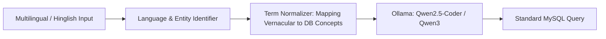
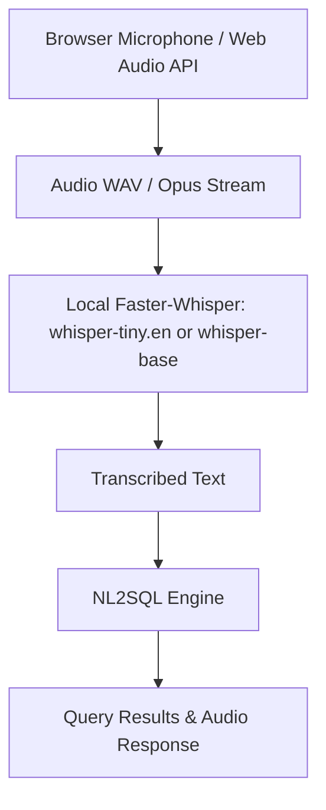
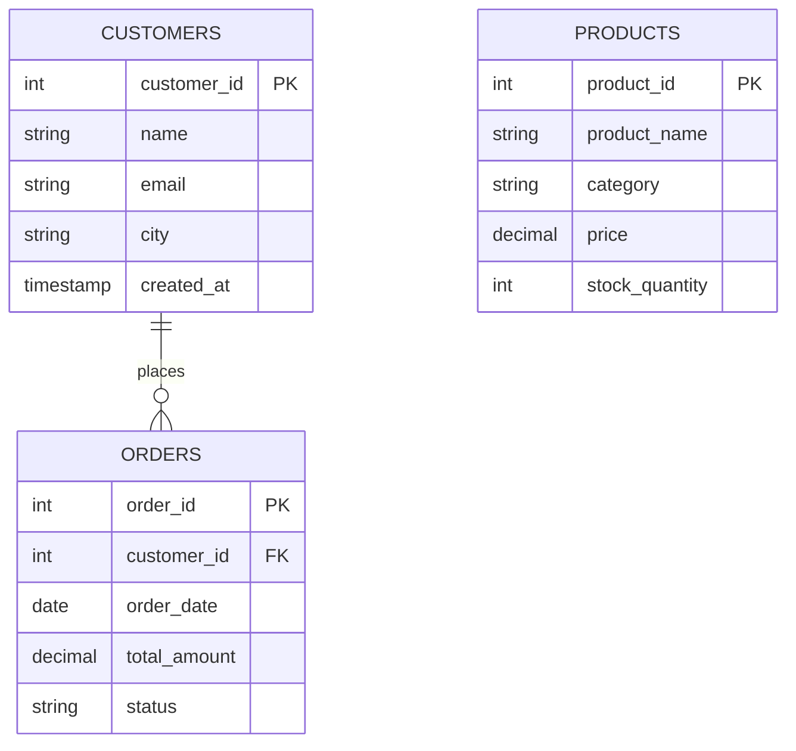

# Feature Ideation & Innovation Roadmap

This document explores five high-impact, forward-looking features designed to transform the NL2SQL platform into a multimodal, multilingual, and intelligent database copilot.

---

## 1. Multilingual & Cross-Lingual Querying

### Concept & Motivation
In diverse business and educational environments, users often think and communicate in regional languages, code-mixed dialects, or transliterated vernaculars (such as **Hinglish** or **Marathi**). Enabling users to speak or write queries in their mother tongue removes language barriers from data analytics.

### Concrete Query Examples
- **Hinglish:**
  > *"Pune ke saare customers dikhao jinhone 1000 se jyada spend kiya hai aur status completed hai"*
  > $\rightarrow$ `SELECT c.*, o.total_amount FROM customers c JOIN orders o ON c.customer_id = o.customer_id WHERE c.city = 'Pune' AND o.total_amount > 1000 AND o.status = 'completed';`
- **Marathi (मराठी):**
  > *"सर्वात जास्त विक्री झालेल्या टॉप ३ उत्पादनांची नावे दाखवा"*
  > $\rightarrow$ `SELECT p.product_name, SUM(o.total_amount) AS revenue FROM products p JOIN orders o ON ... GROUP BY p.product_id ORDER BY revenue DESC LIMIT 3;`
- **Hindi (हिंदी):**
  > *"पिछले महीने में कुल कितने ऑर्डर्स रद्द हुए हैं?"*
  > $\rightarrow$ `SELECT COUNT(*) FROM orders WHERE status = 'cancelled' AND order_date >= DATE_SUB(CURRENT_DATE, INTERVAL 1 MONTH);`

### Technical Implementation Blueprint

1. **Model Capability:** Both `qwen2.5-coder:7b` and `qwen3:8b` have strong native multilingual representations and understand Devanagari script as well as Romanized transliteration (Hinglish).
2. **System Prompt Adaptation:**
   - Explicitly instruct the model:
     ```text
     The user query may be in English, Hindi, Marathi, or Romanized Hinglish/Marathlish.
     Analyze the semantic intent regardless of language, resolve colloquial business phrases
     (e.g., 'sabse jyada' -> MAX/ORDER BY DESC, 'kitne log' -> COUNT(*)),
     and output valid, standard MySQL.
     ```
3. **Colloquial Term Glossary:** Maintain a small local dictionary mapping common regional business slang (e.g., *"khata"*, *"jama"*, *"bikri"*, *"graahak"*) to database terms (`account`, `credit`, `sales`, `customers`).

---

## 2. Voice-Powered Database Interaction

### Concept & Motivation
Allow executives, field managers, and accessibility-first users to interact with their database hands-free by speaking questions naturally into their microphone.

### Technical Architecture


### Implementation Steps
1. **Audio Recording in Streamlit:**
   - Integrate `streamlit-mic-recorder` or HTML5 Web Audio API directly in the browser.
2. **100% Offline Speech-to-Text via Faster-Whisper:**
   - Use `faster-whisper` running locally with the `base` or `small` model on CPU/CUDA.
   - Processing time for a 3-second voice prompt is typically under $250\text{ms}$ locally.
3. **Phonetic Error Correction:**
   - Often, Whisper might transcribe database table names slightly phonetically (e.g., *"costumers"* instead of *"customers"*).
   - Feed the transcription through a rapid fuzzy matcher (`rapidfuzz`) against table and column names before generating the SQL query.
4. **Voice Feedback (Text-to-Speech):**
   - Use a fast offline TTS engine (like `pyttsx3` or Piper TTS) to read out the summary answer:
     *(e.g., "Found 4 customers from Pune with completed orders.")*

---

## 3. Interactive Visual Schema & ERD Graph

### Concept & Motivation
Users often do not know what questions they can ask because they cannot visualize how tables relate to one another. An interactive **Entity-Relationship Diagram (ERD)** allows users to visually explore schemas and click on tables to construct queries.



### Implementation Steps
1. **Automatic Graph Construction:**
   - Parse `INFORMATION_SCHEMA.KEY_COLUMN_USAGE` to extract all primary-to-foreign-key relationships.
2. **Visual Rendering:**
   - **Static/Crisp View:** Dynamically generate Mermaid.js ERD syntax inside a collapsible `st.expander`.
   - **Interactive Dynamic View:** Use `pyvis` or `streamlit-agraph` to render an interactive physics-based network graph where users can drag tables, zoom in, and inspect column details.
3. **Query Highlighting:**
   - When a query executes, highlight the active tables and join paths in green on the ERD diagram so users visually understand how the data was aggregated.

---

## 4. Natural Language Summarizer & Automated Insights

### Concept & Motivation
Raw SQL tables can be overwhelming for non-technical stakeholders. Instead of just showing a table of 50 rows, the system should act as an **AI Analyst** that automatically extracts key takeaways, trends, and anomalies.

### Example Transformation
* **Query Output Table:**
  | category | total_revenue | order_count |
  | :--- | :--- | :--- |
  | Electronics | $199.98 | 2 |
  | Home & Kitchen | $47.50 | 2 |
* **Generated AI Insight:**
  > 💡 **Executive Summary:** Electronics generated the majority of sales ($199.98, ~81% of total revenue) across 2 orders, while Home & Kitchen accounted for $47.50 across 2 orders. The average basket size in Electronics is 4x higher than Home & Kitchen.

### Implementation Steps
1. **Result Profiler:**
   - Compute basic descriptive statistics on numerical output columns (min, max, sum, mean, percentage distribution) using Pandas.
2. **Summary Prompting:**
   - Pass the top 5 rows and statistical summary to Ollama with a compact prompt:
     ```text
     Given this SQL result set, provide a concise 2-sentence executive insight highlighting the key trend, highest contributor, or significant anomaly.
     ```
3. **UI Badging:**
   - Display insights in an alert card directly above the data grid for immediate digestion.

---

## 5. Query History, Bookmarking & AI Performance Optimizer

### Concept & Motivation
Power users frequently run the same queries periodically (daily reports, monthly auditing). An intelligent history and bookmarking manager turns the tool into a daily analytics workstation, while an **AI Index Optimizer** helps database administrators optimize their schema.

### Feature Set
1. **Query Favorites & Saved Bookmarks:**
   - Allow users to "Star" / bookmark high-value questions with custom titles (e.g., *"Weekly Revenue Report"*).
   - Instant 1-click rerun button without typing.
2. **Searchable Session History:**
   - Store all prompts, generated queries, execution timestamps, and execution durations in a lightweight local SQLite database (`history.db`).
   - Full-text search to quickly find past queries.
3. **AI Index & Performance Optimizer (`EXPLAIN` Copilot):**
   - Add a *"⚡ Optimize Query"* button.
   - The app executes `EXPLAIN <query>` on MySQL, fetches query plan metrics (type of scan: `ALL`, `index`, `range`), and asks Ollama:
     ```text
     Analyze this MySQL EXPLAIN plan. Identify if any full table scans occur.
     If appropriate, recommend the exact CREATE INDEX statement to improve performance.
     ```
   - Suggests indexing recommendations:
     *(e.g., "Adding `CREATE INDEX idx_orders_customer_date ON orders(customer_id, order_date);` will reduce scanned rows from 10,000 to 12.")*
