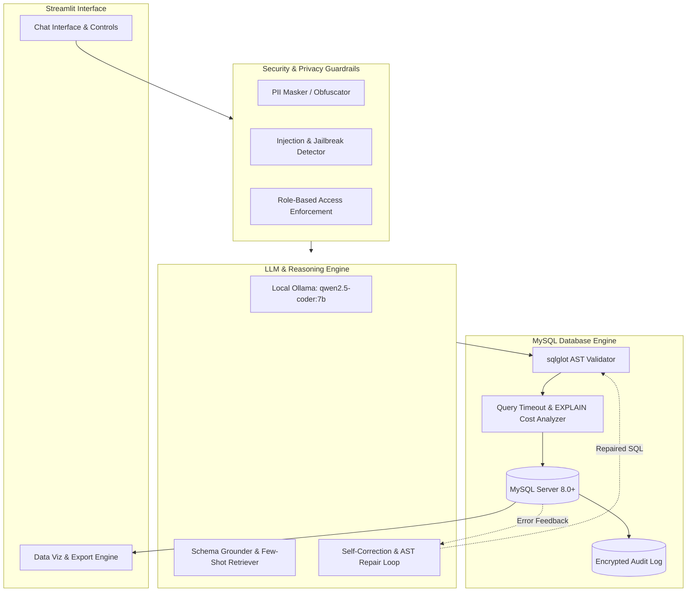

# Production Roadmap: Building a Production-Grade NL2SQL System

This document outlines the architectural blueprints, engineering practices, and remaining implementations required to transition this prototype into an enterprise-ready, reliable, simple, and privacy-preserving Natural Language to SQL (NL2SQL) platform.

---

## Architecture Overview



---

## Section A: Reliability & Accuracy

### 1. Multi-Stage Self-Healing & Reflection Loop
* **The Problem:** Even high-performing code LLMs can occasionally reference slightly misspelled columns, invalid aggregate functions, or violate MySQL group-by strictness (`ONLY_FULL_GROUP_BY`).
* **Implementation Blueprint:**
  - When query execution produces an operational or syntax error (`OperationalError`, `ProgrammingError`), capture:
    1. The exact database error string (e.g. `Error 1054: Unknown column 'total' in 'field list'`).
    2. The failed SQL statement.
    3. The active schema and table definitions.
  - Automatically invoke a reflection chain with temperature $0.0$, directing the model to inspect the schema specifically for the missing or invalid identifier.
  - Impose a maximum retry threshold (typically 2-3 iterations) before gracefully falling back to human intervention.

### 2. Semantic Schema Grounding & Value Normalization
* **The Problem:** In production databases, queries often filter on categorical strings where user input differs in casing, abbreviations, or wording (e.g. user asks for `"pending items"`, but the database stores `"STATUS_PENDING"` or `"0"`).
* **Implementation Blueprint:**
  - **Categorical Extraction:** During schema extraction, inspect `ENUM` definitions and sample distinct values for columns with cardinality $\le 50$.
  - **Vectorized Value Matching:** For open-ended strings (such as product names or cities), use a lightweight local vector store (e.g. ChromaDB or SQLite with FTS5) to match user-provided keywords to actual database values before injecting them into the SQL prompt.
  - **Temporal Standardization:** Provide explicit rules for current date resolution (`CURRENT_DATE`, `NOW() - INTERVAL 30 DAY`) to avoid hallucinated calendar references.

### 3. AST-Based Query Validation & SQL Transpilation
* **The Problem:** Regex-based string inspection cannot reliably detect nested subqueries, malicious multi-statements, or dialect-specific quirks.
* **Implementation Blueprint:**
  - Parse every generated query into an Abstract Syntax Tree (AST) using `sqlglot` targeting the `mysql` dialect.
  - Verify semantic constraints:
    - Exactly one top-level statement.
    - Statement type must belong to approved sets (`Select`, `Insert`, `Update`, `Delete`).
    - Enforce mandatory `WHERE` clauses on `UPDATE` and `DELETE` statements to eliminate catastrophic accidental table overwrites.
    - Automatically append a `LIMIT` clause on unbounded `SELECT` statements if absent.

### 4. Query Cost Estimation & Safe Execution Guardrails
* **The Problem:** A poorly planned multi-table `CROSS JOIN` or query without index usage can exhaust server CPU and RAM.
* **Implementation Blueprint:**
  - **EXPLAIN Cost Check:** Before executing heavy read queries, run `EXPLAIN FORMAT=JSON <query>` to retrieve the estimated query cost and row scan count.
  - **Threshold Policy:** If estimated scanned rows exceed a configurable threshold (e.g., $> 250,000$ rows), halt and display a warning asking the user for confirmation.
  - **Statement Timeout:** Enforce server-side execution boundaries via `SET SESSION max_execution_time = 15000` (15 seconds) to ensure runaway queries are terminated by MySQL directly.

### 5. Multi-Table Join Path Ambiguity Resolution
* **The Problem:** In complex schemas with shared foreign keys, multiple valid join paths can exist between tables (e.g., `customers` joining to `orders` via `customer_id`, or via a `shipping_addresses` intermediary).
* **Implementation Blueprint:**
  - Model the database schema as a bidirectional directed graph using NetworkX where nodes are tables and edges are foreign keys.
  - When the user query touches disjoint tables, compute the shortest path or minimum spanning tree to inject explicit `JOIN ... ON ...` hints into the LLM prompt.

---

## Section B: Simplicity & UI/UX (Streamlit Native)

### 1. Conversational Chat-Native Interface
* **Transition:** Evolve from the current step-by-step form into a modern chat experience using `st.chat_message` and `st.chat_input`.
* **State Management:**
  - Retain chat history in `st.session_state["messages"]`.
  - Maintain message pairings: User Prompt $\rightarrow$ Generated SQL $\rightarrow$ Execution Output $\rightarrow$ Natural Language Explanation.
  - Support multi-turn context retention (e.g., *"Filter the previous result to show only those created after June"*).

### 2. Auto-Discovery & Zero-Configuration Onboarding
* **Dynamic Connection Profiles:**
  - Save named connection profiles (e.g., `Local Dev`, `Staging Analytics`) securely in encrypted local storage (`keyring` or local SQLite).
  - Populate available databases dynamically via `SHOW DATABASES` rather than requiring manual text entry.
* **Ollama Model Discovery:**
  - Query `ollama.list()` dynamically to populate a sidebar model selector (e.g., `qwen2.5-coder:7b`, `qwen3:8b`, `deepseek-coder`).
  - Display model memory consumption and status (active/idle).

### 3. Automated Business Intelligence & Dynamic Visualizations
* **Intelligent Charting:**
  - When a query returns tabular aggregate data, automatically analyze column data types:
    - 1 Categorical column + 1 Numerical column $\rightarrow$ Auto-render a Bar Chart (`st.bar_chart`).
    - 1 Temporal column (Date/Timestamp) + Numerical column $\rightarrow$ Auto-render a Line Chart (`st.line_chart`).
    - 2 Numerical columns $\rightarrow$ Auto-render a Scatter Plot.
  - Include an interactive chart editor powered by Plotly or Altair allowing users to toggle axes and chart types.

### 4. One-Click Reporting & Export Capabilities
* Provide structured export options directly below each table:
  - **CSV Export:** Streamable UTF-8 encoded CSV.
  - **Excel Export:** Formatted `.xlsx` with automatic column width adjustments and bold headers.
  - **Copy SQL:** One-click clipboard copy with formatted SQL syntax highlighting.

### 5. Explainable SQL & Confidence Feedback
* Provide an expandable *"Why this query?"* summary:
  - Natural language explanation of every clause (`SELECT`, `JOIN`, `WHERE`, `GROUP BY`).
  - List of database tables and columns used.
  - Visual diff viewer showing what was modified if the user edits the query manually or if auto-fix was triggered.

---

## Section C: Privacy & Enterprise Security

### 1. 100% Air-Gapped Local Deployment
* **Zero External Telemetry:**
  - Set `STREAMLIT_BROWSER_GATHER_USAGE_STATS=false` in `.streamlit/config.toml`.
  - Run Ollama strictly on `127.0.0.1:11434` with `OLLAMA_ORIGINS=""` to block external cross-origin calls.
  - Guarantee that no database schema, query, or table data ever leaves the local host machine.

### 2. Sensitive Data & PII Masking
* **Client-Side Obfuscation:**
  - Before sending any table schema or sample rows to the LLM prompt, scan column names for sensitive keywords (`password`, `ssn`, `credit_card`, `token`, `secret`).
  - Redact sample data values for sensitive columns using synthetic placeholders (e.g., `user_token: '***MASKED***'`).
  - Provide an option to exclude sensitive tables entirely from the schema extraction prompt.

### 3. Principle of Least Privilege & RBAC
* **Connection Hardening:**
  - Default to a read-only MySQL user role:
    ```sql
    CREATE USER 'readonly_analyst'@'localhost' IDENTIFIED BY 'StrongPassword!';
    GRANT SELECT, SHOW VIEW ON ecommerce_db.* TO 'readonly_analyst'@'localhost';
    FLUSH PRIVILEGES;
    ```
  - For write operations, require explicit administrator toggle in the application settings, running mutations inside strict ACID transactions (`conn.begin()`) with immediate rollback capability.

### 4. Tamper-Evident Audit Logging
* Record every transaction in an append-only SQLite database or encrypted file log:
  - **Timestamp:** ISO 8601 UTC timestamp.
  - **User Identity:** Connected session username and host IP.
  - **Natural Language Question:** Raw user input.
  - **Generated SQL:** Output from the LLM.
  - **Execution Status:** Success / Error code.
  - **Rows Affected / Returned:** Quantitative impact.
  - **Execution Latency:** Time in milliseconds.

### 5. Prompt Injection & Jailbreak Defense
* **Input Sanitization:**
  - Strip known adversarial jailbreak patterns (`"Ignore previous instructions"`, `"System override"`, `"DROP ALL TABLES"`).
  - Use structured message formatting (`ChatPromptTemplate` with separated System, Human, and AI roles) rather than raw string concatenation.
  - Validate that the output string parses strictly as valid SQL; reject any output containing markdown conversational prose or non-SQL instructions.
